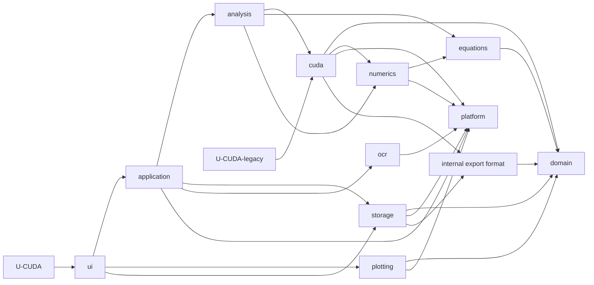

# U-CUDA architecture

## Dependency direction



`ucuda_export_format` is an internal implementation target in storage. It lets compute-time streaming and later GUI export share byte-identical CSV writers without making `ucuda_cuda` depend on the complete `ucuda_storage` library.

Forbidden directions include domain to any higher module, storage to application/UI/plotting, CUDA to application/UI/plotting, analysis to UI/plotting, and plotting to application.

## Runtime data flow

1. Desktop input enters `AppModel`.
2. Equations converts text or LaTeX into a domain `System` and generates a selected numerical scheme.
3. Analysis sessions snapshot user-facing strings and settings into typed requests.
4. Numerics compiles or runs CPU code; CUDA compiles NVRTC modules and launches GPU work.
5. Workers write only their request/result objects and cancellation/progress tokens.
6. The main loop calls `AppModel::tick`; it polls futures, applies results, advances queues, and persists completed sessions.
7. UI reads model/session data and associates projections with UI-owned plot views by stable runtime IDs.
8. Plotting uploads or interoperates with GPU buffers and owns every OpenGL resource.

Closing the application releases UI and plotting resources before ImGui, GLFW, and the OpenGL context are destroyed.

## NVCC and NVRTC source flow

NVCC builds the static CUDA implementation from `libs/cuda/src`. Runtime NVRTC compilation loads templates from `resources/kernels`. [cmake/PackRuntime.cmake](cmake/PackRuntime.cmake) copies templates and assembles the flat runtime headers from the same domain and CUDA sources used by the normal build.

When device helpers, `configCUDA.h`, adaptive integration, or kernel includes change, update the packer input list and run `gpu_smoke` from a clean runtime kernel directory. Cache keys must include every option that changes generated PTX, including FMA behavior and runtime algorithm knobs.

## Persistence and ownership

- Domain owns serializable types, settings, request/result values, plot descriptions, and export snapshots.
- Analysis owns futures, progress/cancellation tokens, session transitions, and computation orchestration.
- Storage owns JSON, settings, system-library layout, and CSV formatting.
- Application owns the active system, cross-analysis queues, dirty/save decisions, and global ticking.
- UI owns widget state and plot-view instances.
- Plotting owns OpenGL buffers, textures, cameras, renderers, and framebuffer capture.
- Platform owns clipboard transfer and OS-specific paths/processes/dialogs.

Runtime-only IDs and GPU/GL handles are never written to JSON.

## Runtime layout

```text
<executable directory>/
  U-CUDA[.exe] or U-CUDA-legacy[.exe]
  kernels/
  library_template/
  ocr_server.py
  required DLLs on Windows
```

The application resolves packaged resources relative to the executable, not the current working directory. In a source build, writable user systems remain in `U-CUDA/library/`; `U_CUDA_LIBRARY` overrides that location.

## Documentation map

The root [README.md](README.md) answers “where should I start?”. [libs/README.md](libs/README.md) maps library ownership. Directory README files explain design and entry points; directory AGENTS files contain operational rules for coding agents.
