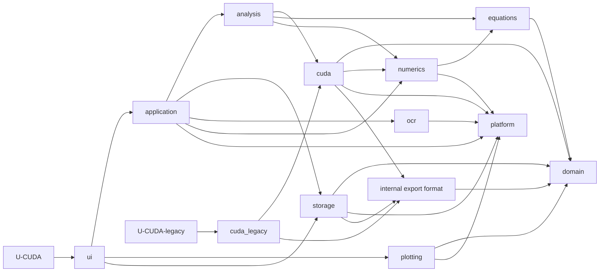

# U-CUDA architecture

## Two build definitions

Both describe the same sources and the same module graph below.

- `U-CUDA.sln` / `U-CUDA/U-CUDA.vcxproj` (Windows, Visual Studio): one project that compiles every `libs/` source into the executable. Release builds the desktop app (`apps/desktop`), Debug the legacy entry (`apps/legacy`); output goes to `x64\<Configuration>\`. The post-build step runs [cmake/PackRuntime.cmake](cmake/PackRuntime.cmake) to pack `kernels/` and the other runtime files.
- CMake: one library target per module, so the dependency arrows below are enforced by the linker; used for tests (`ctest`), Linux and the headless configuration.

[tests/vcxproj_sync.cmake](tests/vcxproj_sync.cmake) checks that both list the same `libs/` sources. A single Visual Studio project does not enforce module boundaries, so [tests/layer_rules.cmake](tests/layer_rules.cmake) checks the include direction instead.

## Dependency direction



`ucuda_export_format` is an internal implementation target in storage. It lets compute-time streaming and later GUI export share byte-identical CSV writers without making `ucuda_cuda` depend on the complete `ucuda_storage` library.

Forbidden directions include domain to any higher module, storage to application/UI/plotting, CUDA to application/UI/plotting, analysis to UI/plotting, plotting to application, and UI to CUDA/numerics. UI reaches computation through application: `AppModel` for tasks, `compute_services.h` for direct checks (CPU compiler, KRS indices, controller body, circuit files, netlist export).

One deliberate exception: domain includes the layout part of `resources/kernels/ucuda_adaptive.cuh` (`UCUDA_ADAPT_LAYOUT_ONLY`) from `adaptive_settings.h`. `UcudaAdaptParams` and the step-controller structures are passed to kernels byte for byte, so host and device keep one definition. [tests/layer_rules.cmake](tests/layer_rules.cmake) checks both rules.

## Runtime data flow

1. Desktop input enters `AppModel`.
2. Equations converts text or LaTeX into a domain `System` and generates a selected numerical scheme.
3. Analysis sessions snapshot user-facing strings and settings into typed requests.
4. Numerics compiles or runs CPU code; CUDA compiles NVRTC modules and launches GPU work.
5. Workers write only their request/result objects and cancellation/progress tokens.
6. The main loop calls `AppModel::tick`; it polls futures, applies results, advances queues, and persists completed sessions.
7. UI reads model/session data and associates projections with UI-owned plot views by stable runtime IDs.
8. Plotting uploads or interoperates with GPU buffers and owns every OpenGL resource.

Closing the application releases UI and plotting resources before ImGui, GLFW, and the OpenGL context are destroyed.

## NVCC and NVRTC source flow

NVCC builds the static CUDA implementation from `libs/cuda/src`. Runtime NVRTC compilation loads templates from `resources/kernels`. [cmake/PackRuntime.cmake](cmake/PackRuntime.cmake) copies templates and assembles the flat runtime headers from the same domain and CUDA sources used by the normal build.

When device helpers, `configCUDA.h` or kernel includes change, update the packer input list and run `gpu_smoke` from a clean runtime kernel directory. Cache keys must include every option that changes generated PTX, including FMA behavior and runtime algorithm knobs.

## Persistence and ownership

- Domain owns serializable types, settings, request/result values, plot descriptions, and export snapshots. Each session's persistent part is a domain `<Name>State`.
- Analysis owns futures, progress/cancellation tokens, session transitions, and computation orchestration: each session is `<Name> : <Name>State` in analysis.
- Storage owns JSON, settings, system-library layout, and CSV formatting. It serializes `<Name>State`; sessions owning other sessions (Basins phase slots, Custom) pass the owned parts explicitly.
- Application owns the active system, cross-analysis queues, dirty/save decisions, and global ticking, and wraps storage's state serializers for whole sessions (`session_persistence.h`). `AppModel` is layered: `AppSettings` (mirror of `AppConfig`) <- `SystemEditor` (the edited system, its code generation and library record) <- `AppModel` (sessions, engine, queues, plot windows, broadcast and undo). The Library editor's scratch buffer is a `SystemEditor`, not a second `AppModel`.
- The GPU cost estimator (`time_estimate.h`) belongs to application; domain's trajectory work description (`traj_work.h`) contains only values.
- DAE IR, device expansion and scheme generation belong to equations; domain owns serializable DAE/Newton settings and sparse numerical data types. Numerics owns the CPU BDF driver and SPICE/KiCad import; CUDA owns GPU/NVRTC execution of the same adaptive/BDF algorithms, and runtime packaging includes their common headers.
- UI owns widget state and plot-view instances.
- Plotting owns OpenGL buffers, textures, cameras, renderers, and framebuffer capture.
- Platform owns clipboard transfer and OS-specific paths/processes/dialogs.
- Test executables depend on the owning libraries and never require GUI. The GoogleTest/Benchmark dependencies and the artifact/baseline CLI live only in `tests/`.

Runtime-only IDs and GPU/GL handles are never written to JSON.

## Runtime layout

```text
<executable directory>/
  U-CUDA[.exe] or U-CUDA-legacy[.exe]
  kernels/
  library_template/
  ocr_server.py
  required DLLs on Windows
```

The application resolves packaged resources relative to the executable, not the current working directory. In a source build, writable user systems remain in `U-CUDA/library/`; `U_CUDA_LIBRARY` overrides that location.

## Documentation map

The root [README.md](README.md) answers “where should I start?”. [libs/README.md](libs/README.md) maps library ownership. Directory README files explain design and entry points; directory AGENTS files contain operational rules for coding agents.
